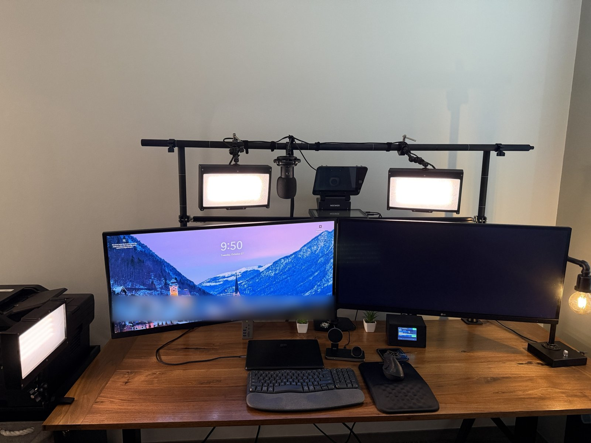
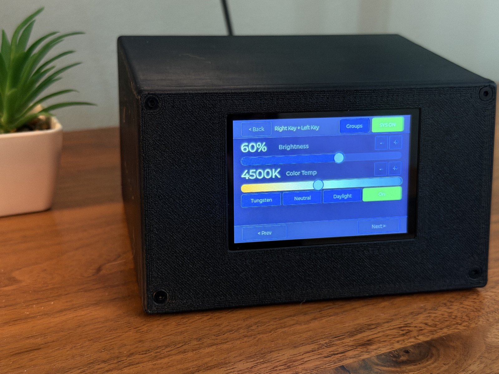
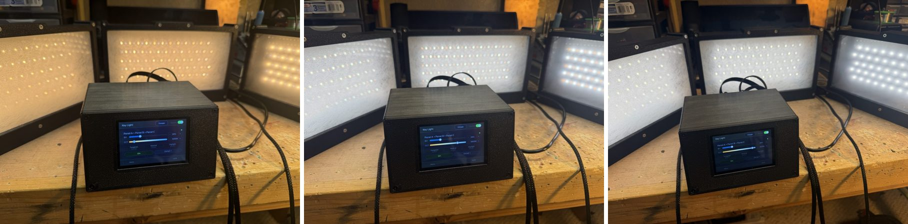
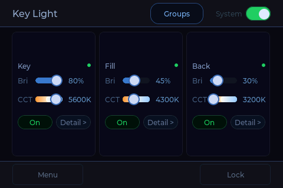

# CCTRL Key Light Controller

A touchscreen controller for up to three tunable-white (CCT) LED panels, designed for video and photography lighting. Each panel has separate warm and cool LED channels; the controller sets colour temperature (2700 to 6500 K) and brightness per panel or per group, and protects each panel with current sensing and a per-panel fuse.

By [Lautus Creations](https://github.com/lautus-creations).









**Documentation:** [Build Guide](docs/BUILD.md) · [User Guide](docs/USER_GUIDE.md) · [Hardware](hardware/)

---

## Features

- **Three panel ports**, each with a high-side switch, a fuse and independent warm/cool PWM channels.
- **Flicker-free dimming:** 10-bit PWM at 25 kHz by default, selectable 20/25/30/39 kHz for testing against a specific camera. Brightness follows a perceptual curve (linear available).
- **Groups and presets:** link panels to move together; three named colour-temperature presets.
- **Current and voltage sensing** on every channel and panel rail, with latched protection:
  - Trips (panel switched off until re-armed): over-current, MOSFET stuck on, dead rail (blown fuse or no 24 V), high-side switch stuck on.
  - Warnings: open channel or unplugged panel, low rail voltage, sensing offline.
  - A tripped panel stays off until it is switched off and on again or reset from the fault popup.
- **Panel Check:** lights each channel alone and compares its current with a reference saved for that port, so different panel sizes can share one controller.
- **Diagnostics:** live current, duty and rail voltage per panel; uptime, last fault, peak currents and I2C error counts.
- **Screen lock** and idle screen sleep (first touch wakes the screen without acting on the UI).
- **Serial console** over USB for status, panel on/off and diagnostics.
- Settings are saved to flash and restored at power-up. A loop watchdog restarts the controller if the firmware stops responding; outputs are held off by hardware during the restart.

---

## Hardware

Controller PCB rev 0.2.

| Function | Part |
|---|---|
| MCU | ESP32-S3-DevKitC-1-N16R8 (16 MB flash, 8 MB PSRAM), socketed |
| Display | MSP3526: 3.5" 320×480 IPS, ST7796U, SPI ([LCDwiki](https://www.lcdwiki.com/3.5inch_IPS_SPI_Module_ST7796): datasheets and 3D model) |
| Touch | FT6336U capacitive, I2C 0x38 |
| Input | 24 V terminal block, ATM mini blade fuse, reverse-polarity P-FET (AO4485), TVS clamp |
| Logic supply | 24 V to 5 V SIP buck module (OKI-78SR-5/1.5 footprint) |
| Panel switching | Per panel: high-side P-FET (DMP6023LSS) and Nano2 fuse. Per channel: low-side N-FET (AOD4184A) with Schottky freewheel diode |
| Sensing | Per channel: 25 mΩ shunt and INA181A2. Per panel: ADS1115 ADC for both channel currents and the panel rail voltage |
| Panel output | 3.81 mm pluggable terminal block per panel: pin 1 +24 V, pin 2 warm −, pin 3 cool − |

Each panel is switched on its own rail by the high-side P-FET, so a fault cuts only that panel. The gates of all output switches are held off by pull-downs until the firmware drives them, so outputs stay off through reset and boot.

Schematics, the JLCPCB order package (gerbers, BOM, pick-and-place) and enclosure files are in [`hardware/`](hardware/). STEP models of the controller housing and the board are attached to the [release](../../releases).

---

## Ratings and Fuse Selection

Choose fuses for the panels you connect. Do not exceed the caps below; the board's copper and current sensing are sized to them.

| Fuse | How to size it | Do not exceed |
|---|---|---|
| Input (ATM mini blade) | Total panel current at full brightness × 1.25, plus 0.5 A for the controller | **7.5 A** |
| Per panel (Nano2, Littelfuse 451/453 very fast-acting) | Panel current at full brightness × 1.25, rounded up to the next standard value; not below 1 A | **3 A** |

- Maximum continuous load: **2.4 A per panel, 6 A total** at 24 V.
- A panel's current at full brightness is the higher of its warm or cool channel at 100 %. The controller never drives warm and cool above a combined 100 %.
- Connectors and harness wiring must be rated for the fuse fitted. Use GX12 connectors rated 5 A or more, and 20 AWG wire for panels above 1.5 A or long runs.

---

## First Use

1. Connect the panels and 24 V, then power up.
2. Open **Menu > Diagnostics > Check** and tap **Start**. Each panel lights warm, then cool.
3. With known-good panels connected, tap **Save reference**. Later checks compare each channel with this reference (pass within ±25 %).

Full assembly and bring-up steps are in the [Build Guide](docs/BUILD.md).

The saved reference also sets each port's over-current trip limit (2× the reference, between 0.40 and 2.40 A; 1.80 A until a reference is saved). **Port Configuration > Trip limit** shows the limit, allows a manual override, and has **New panel** to clear the reference after swapping a panel.

---

## Building the Firmware

Prebuilt images are attached to each [release](../../releases); see [Flash the Firmware](docs/BUILD.md#6-flash-the-firmware). To build from source:

### Requirements

- [PlatformIO](https://platformio.org/) (VS Code extension or CLI)
- ESP32-S3-DevKitC-1-N16R8

The platform is pinned to `platformio/espressif32 @ 6.12.0` (Arduino-ESP32 2.0.17). The firmware uses the 2.0.x LEDC API and does not build on Arduino core 3.x. TFT_eSPI is configured entirely through build flags in `platformio.ini`.

### Build and flash

```bash
cd firmware
pio run                      # first run downloads TFT_eSPI and LVGL
pio run --target upload
pio device monitor           # 115200 baud, native USB port
```

Serial output uses the DevKit's native USB port (`ARDUINO_USB_CDC_ON_BOOT=1`). LVGL reads its configuration from `firmware/lv_conf.h` (set by `LV_CONF_PATH` in `platformio.ini`); nothing needs copying into `.pio`.

### Serial console

Type `help` in the monitor. Commands include `sense`, `stream <ms>`, `faults`, `check`, `on` / `off` (whole system) and `on A` / `off B` (one panel). The full list is in the [User Guide](docs/USER_GUIDE.md#serial-console).

---

## Repository Layout

```
docs/         Build guide, user guide, screenshots and wiring diagram
firmware/     PlatformIO project (ESP32-S3, Arduino framework, LVGL 8)
hardware/     Schematics, gerbers, BOM, enclosure and reference panel design
tools/        Small test sketches for identifying DevKit board variants
```

---

## Notes

- **DevKit clones:** some ESP32-S3-DevKitC-1 clones drive their onboard RGB LED from GPIO 48, which this board uses for Panel C cool PWM. The LED shows random colours while Panel C is lit. It is harmless and can be covered or removed.
- **Display backlight:** the backlight is switched fully on or off. PWM dimming of this module's backlight interferes with its capacitive touch controller.

---

## License

Copyright (c) 2026 DrEvan.

| Part | License |
|---|---|
| Firmware and tools (`firmware/`, `tools/`) | [GPL-3.0-or-later](LICENSE) |
| Hardware design (`hardware/`: schematics, PCB, gerbers, BOMs, enclosure and panel CAD) | [CERN-OHL-S-2.0](hardware/LICENSE) |
| Documentation and photos (`docs/`, README files) | [CC BY-SA 4.0](docs/LICENSE) |

All three are share-alike licenses. You may build, modify and sell anything from this repository, provided that modified versions you distribute are released under the same license with their full source, and that the original is credited.

The Lautus Creations and CCTRL names and logos are not covered by these licenses. Derivative products may not use them in a way that suggests they come from or are endorsed by Lautus Creations.

Third-party libraries used by the firmware keep their own licenses:
- [TFT_eSPI](https://github.com/Bodmer/TFT_eSPI) (FreeBSD, MIT and BSD; see the library license)
- [LVGL](https://lvgl.io) (MIT)
- [Arduino-ESP32](https://github.com/espressif/arduino-esp32) (LGPL-2.1, Espressif)
