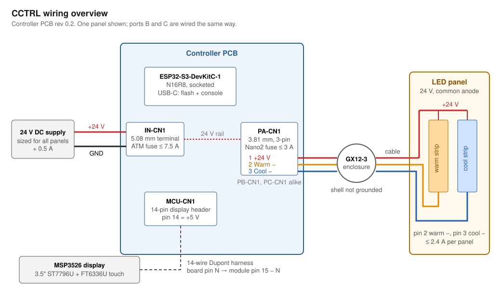
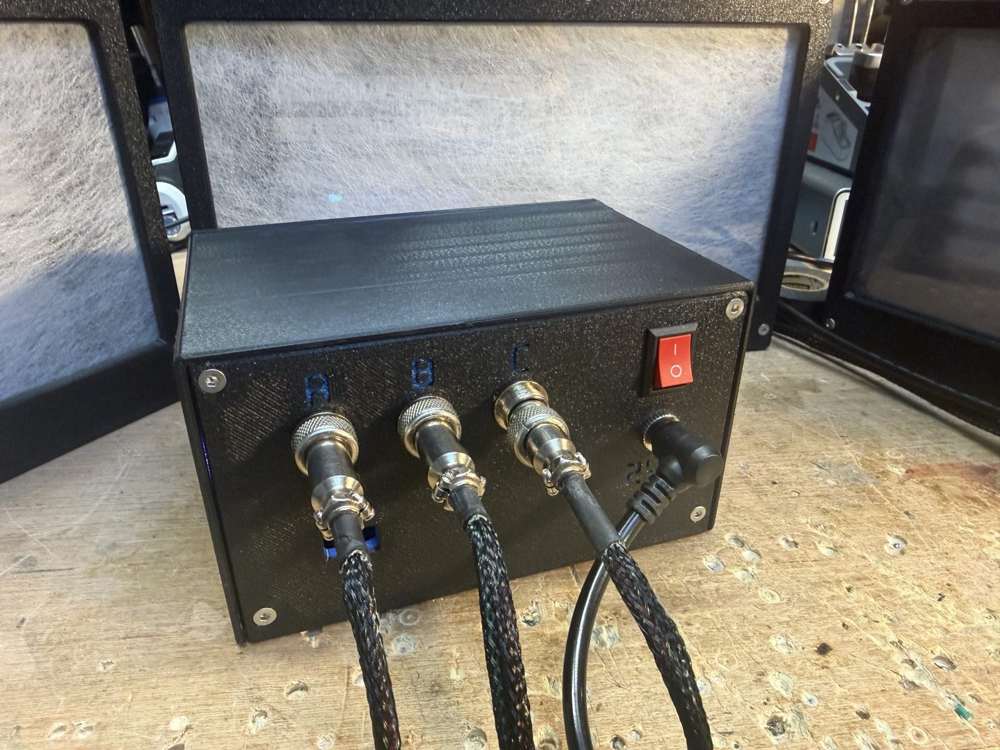
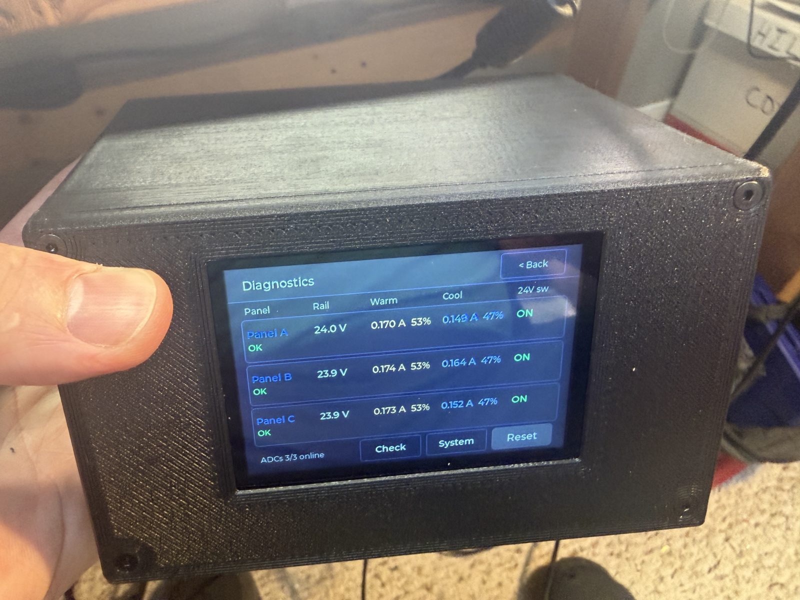

# Build Guide

This guide covers building one controller: ordering and assembling the PCB, wiring the display and panels, flashing the firmware, and first power-up.



---

## 1. Parts

There are two BOMs:

| File | Contents | Use |
|---|---|---|
| [`hardware/gerber/CCTRL_rev0.2_BOM_*.xlsx`](../hardware/gerber/) | Every part on the board, as exported from EasyEDA, with LCSC part numbers | Upload to JLCPCB with the gerbers and pick-and-place file |
| [`hardware/bom/CCTRL_rev0.2_BOM_hand-assembly.csv`](../hardware/bom/) | Through-hole parts, the DevKit socket headers, and everything off the board | Order the parts you will fit yourself from LCSC (part numbers given) or any distributor |

The hand-assembly BOM marks the test points and expansion headers as optional. The enclosure is printed from [`hardware/mechanical/enclosure/pcb/`](../hardware/mechanical/enclosure/pcb/) and needs M3 heat-set inserts, standoffs and screws (see [section 7](#7-enclosure)).

### DevKit fit

The DevKit sits in two 1×22 female headers with rows **25.4 mm (1.0 in)** apart. ESP32-S3 DevKit boards from different sources vary in row spacing and LED wiring, so measure yours before ordering. The test sketches in [`tools/`](../tools/) identify a board's variant.

---

## 2. Order the PCB

1. Upload `CCTRL_rev0.2_gerber_*.zip` to JLCPCB. Choose 1 oz outer copper or heavier; the current ratings assume 1 oz.
2. Enable assembly and upload the BOM and pick-and-place files from `hardware/gerber/`.
3. **Deselect MCU-U1 (the DevKit)** in the assembly part list. It is in the BOM so the footprint has a part number; the DevKit is socketed by hand.
4. Through-hole parts can be assembled by JLCPCB or deselected and soldered by hand. Order anything you deselect, and the off-board parts, from the hand-assembly BOM.

<!-- Photo: assembled board as received, top side -->

---

## 3. Assemble the Board

1. Cut a 22-pin length from each 1×40 female header strip: pull the 23rd contact and cut through its hole with flush cutters, then file the end smooth. Solder the two headers into MCU-U1. Plug the DevKit in while soldering so the headers stay square, then remove it.
2. Fit the remaining through-hole parts from the hand-assembly BOM. Observe polarity on the electrolytic capacitors.
3. Fit the fuses: the ATM blade fuse in IN-F1 and a Nano2 fuse in each of PA-F1, PB-F1 and PC-F1. Size them from the [fuse table](../README.md#ratings-and-fuse-selection).
4. Leave the DevKit and display off for now.

### Board reference

| Designator | Function |
|---|---|
| IN-CN1 | 24 V input, 5.08 mm terminal block |
| IN-F1 | Input fuse holder (ATM mini blade) |
| PA-CN1, PB-CN1, PC-CN1 | Panel outputs, 3.81 mm: pin 1 +24 V, pin 2 warm −, pin 3 cool − |
| PA-F1, PB-F1, PC-F1 | Panel fuse holders (Nano2) |
| MCU-U1 | DevKit socket |
| MCU-CN1 | 14-pin display header |
| MCU-CN2 | Expansion: GPIO1, GPIO6, GPIO7, TX, RX, 3.3 V, GND, 5 V |
| MCU-CN3 | I2C expansion: SDA, SCL, 3.3 V, GND (shared with touch and the ADCs) |
| MCU-SW1 | Reset button |
| IN-J1, BK-J1 | Test points: 24 V rail and 5 V rail, each with GND |
| PA-J1 (PB, PC) | Test header: GND, warm drain, cool drain, panel +24 V |
| PA-J3 (PB, PC) | Test point: panel rail after the fuse, with GND |

### Indicator LEDs

| LED | On when |
|---|---|
| IN-LED1 (blue) | 24 V present after the input fuse and reverse-polarity switch |
| BK-LED1 (blue) | 5 V logic supply running |
| PA-LED1, PB-LED1, PC-LED1 (blue) | That panel's rail is switched on and its fuse is intact |
| MCU-LED1 (red) | Solid during boot. After boot: off when normal, blinking for a warning, solid for a trip |

---

## 4. Power Check Without the DevKit

Use a bench supply set to 24 V with a current limit of about 0.3 A if one is available.

1. Connect 24 V to IN-CN1, observing polarity. Reverse polarity is blocked by IN-Q1; nothing lights.
2. Check that IN-LED1 and BK-LED1 light.
3. Measure about 24 V at IN-J1 and 5.0 V at BK-J1.
4. The panel LEDs stay off: the high-side switches are held off by pull-downs until the firmware drives them.

Disconnect power before fitting the DevKit.

---

## 5. Display Harness

MCU-CN1 is mirrored relative to the display's pin order: **board pin N connects to module pin 15 − N.** Wire it with 14 male-to-female jumpers (male end into MCU-CN1).

| Board MCU-CN1 | Signal | Module pin |
|---|---|---|
| 14 | +5 V | 1 VCC |
| 13 | GND | 2 GND |
| 12 | LCD_CS (GPIO10) | 3 LCD_CS |
| 11 | LCD_RST (GPIO8) | 4 LCD_RST |
| 10 | LCD_RS / DC (GPIO9) | 5 LCD_RS |
| 9 | MOSI (GPIO11) | 6 SDI(MOSI) |
| 8 | SCK (GPIO12) | 7 SCK |
| 7 | Backlight (GPIO14) | 8 LED |
| 6 | MISO (GPIO13) | 9 SDO(MISO) |
| 5 | SCL (GPIO5) | 10 CTP_SCL |
| 4 | Touch reset (GPIO18) | 11 CTP_RST |
| 3 | SDA (GPIO4) | 12 CTP_SDA |
| 2 | Touch interrupt (GPIO17) | 13 CTP_INT |
| 1 | Not connected | 14 SD_CS |

`Dupont Connector Housing (Screen Side).stl` holds the module-side connectors together so the harness plugs on as one piece.

<!-- Photo: completed display harness -->

---

## 6. Flash the Firmware

Flash before closing the enclosure. The DevKit's native USB port (labelled **USB** on most boards) carries both flashing and the serial console. The DevKit can be powered from USB alone for flashing; the panels need 24 V.

### Prebuilt binary

Each [release](../../../releases) includes `cctrl-firmware-vX.Y.Z.bin`, a single image containing the bootloader, partition table and application.

**From a browser** (Chrome or Edge):

1. Open [esptool-js](https://espressif.github.io/esptool-js/) and click **Connect**, then pick the DevKit's port.
2. Set the flash address to **0x0**, choose the `.bin` file and click **Program**.
3. Press the reset button (MCU-SW1 or the DevKit's RST) when it finishes.

**From the command line:**

```bash
pip install esptool
esptool.py --chip esp32s3 write_flash 0x0 cctrl-firmware-v1.2.0.bin
```

If the port does not connect, hold the DevKit's **BOOT** button, press **RST**, release **BOOT**, and try again.

The single image covers the settings area, so flashing it resets saved settings (names, groups, presets and Panel Check references) to defaults. Run Panel Check and save a reference again afterwards. Updating from source with PlatformIO keeps saved settings.

### From source

See [Building the Firmware](../README.md#building-the-firmware).

---

## 7. Enclosure

Print the parts in [`hardware/mechanical/enclosure/pcb/`](../hardware/mechanical/enclosure/pcb/) in PETG or ABS. A STEP model of the full assembly is attached to the release for reference and modification.

Hardware:

- **20 M3 × 5 × 4 mm heat-set inserts** (M3 thread, 5 mm outer diameter, 4 mm long; the Voron standard size):
  - 4 in the screen panel, for the display mount
  - 4 in the PCB plate panel, for the PCB mount
  - 12 in the case, 4 each for the screen panel, rear panel and PCB plate panel
- **4 M3 × 6 mm standoffs** between the PCB plate panel and the PCB
- **8 M3 × 4 mm (or 6 mm) socket head cap screws**: 4 for the display, 4 for the PCB
- **12 M3 × 8 mm flat head screws** for the case assembly

1. Press the heat-set inserts into the case, screen panel and PCB plate panel.
2. Mount the PCB on the PCB plate panel with four socket head screws, with the M3 × 6 mm standoffs between the plate and the board.
3. Fit the three GX12-3 sockets to the rear panel and wire each to its panel output plug: socket pin 1 to plug pin 1 (+24 V), pin 2 to pin 2 (warm −), pin 3 to pin 3 (cool −). Use wire rated for the panel fuse; 20 AWG covers every allowed fuse.
4. Fit the 24 V DC jack and power switch to the rear panel and wire them to IN-CN1, with the switch in the +24 V lead. Check that the jack's current rating covers the input fuse you fit.
5. Fit the display to the screen panel with four socket head screws and connect the harness.
6. Screw the screen panel, rear panel and PCB plate panel to the case with the twelve flat head screws.



<!-- Photos: PCB on plate, rear panel wiring, display in screen panel -->

---

## 8. Panels

Each panel needs separate warm and cool LED channels sharing a common +24 V:

| GX12-3 pin | Connection |
|---|---|
| 1 | +24 V to both strips |
| 2 | Warm strip − |
| 3 | Cool strip − |
| Shell | Not connected |

Use the same pinout on every panel. A [reference panel design](../hardware/mechanical/panels/reference-design/) is included; each panel needs 7 M3 heat-set inserts, 7 M3 flat head screws and one or two 1/4-20 heat-set inserts (see its README). Any 24 V panel within the [ratings](../README.md#ratings-and-fuse-selection) works.

---

## 9. First Power-Up

1. Connect 24 V with no panels attached.
2. The splash screen appears, then the home screen.
3. Open **Menu > Diagnostics**. Each port shows about 24 V on **Rail** and the footer shows **ADCs 3/3 online**. Ports that are switched on with no panel attached report **Panel not drawing current**, and MCU-LED1 blinks; both clear once panels are connected.
4. In **Menu > Port Configuration**, switch off any port you will not use. Disabled ports are skipped by protection and Panel Check.
5. Connect the panels, then run **Menu > Diagnostics > Check** and tap **Start**. Each panel lights warm, then cool, at 30 %.
6. With known-good panels, tap **Save reference**. This sets each port's over-current trip limit and the baseline for later checks.



See the [User Guide](USER_GUIDE.md) for day-to-day operation.

---

## Troubleshooting

| Symptom | Check |
|---|---|
| Backlight on, screen blank or garbled | Harness order (board pin N to module pin 15 − N), SCK, MOSI, CS, DC |
| Screen works, touch does not | SDA, SCL, CTP_RST, CTP_INT. Console `i2c` should list 0x38 |
| Diagnostics shows **No 24V at boot** | 24 V supply and input fuse. Powering from USB alone runs the screen with no panel supply |
| A port shows **Sensing offline** | Board assembly around that port's ADS1115 (addresses 0x48, 0x49, 0x4A) |
| Panel LED (PA-LED1 etc.) stays off with the panel on | That port's Nano2 fuse |
| A panel trips as soon as it turns on | The panel draws more than its trip limit. In **Port Configuration > Trip limit**, tap **New panel**, then run Check and Save reference |
| DevKit RGB LED shows random colours | Some DevKit variants drive it from GPIO 48, used here for Panel C cool PWM. Harmless |

For anything else, connect a serial monitor at 115200 baud and type `help`.
