# User Guide

All settings save automatically about one second after the last change and are restored at power-up, including which panels were on.

> [!WARNING]
> **Safety and liability**
>
> Building and using this project involves soldering, a mains-powered 24 V supply, and currents of several amps. Mistakes can cause electric shock, fire, burns, or damage to equipment. Build it only if you are competent to do this kind of work, follow the safety instructions for your power supply and tools, and comply with local electrical codes. Never work on the controller or panels while they are powered.
>
> By building or using this project, you acknowledge these risks and voluntarily assume all risk arising from it, including the risk of personal injury or death and of damage to or loss of property. The design, firmware, and documentation are provided "as is" and "with all faults," without warranty of any kind, express or implied. The authors accept no liability for personal injury, death, or property damage or loss arising from their use. This notice is in addition to the warranty disclaimers and limitations of liability in this repository's licenses.

---

## Home

One card per group. With all panels separate, that is one card per panel.

- **Bri** sets brightness (0 to 100 %). **CCT** sets color temperature (2700 to 6500 K).
- **On** switches the group on or off. **Detail** opens the full controls.
- **System** switches every panel on or off together. Each panel's own on/off setting is kept and comes back when System is switched on.
- The dot beside each name shows status: green on, gray off, amber warning, red tripped.

When panels are linked, cards get wider and gain **−** / **+** buttons for 5 % and 100 K steps:

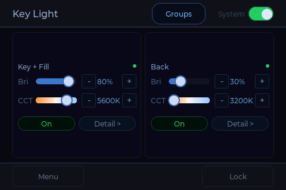

## Panel Detail

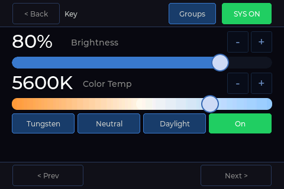

Large brightness and color temperature controls with **−** / **+** steps, the three presets, and **On**. Controls act on the whole group. **Prev** and **Next** move between groups. **SYS** is the System switch.

## Groups

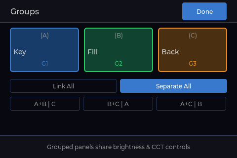

Grouped panels share brightness and color temperature. Choose **Link All**, **Separate All**, or one of the pairings. Changes apply immediately.

## Lock and Idle Screen

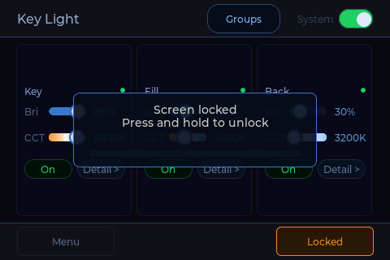

**Lock** ignores touches so the controls cannot be bumped during a shoot. Press and hold anywhere for 1.5 seconds to unlock.

The backlight turns off after one minute without a touch. The first touch turns it back on and is not passed to the controls.

---

## Settings

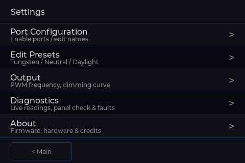

### Port Configuration

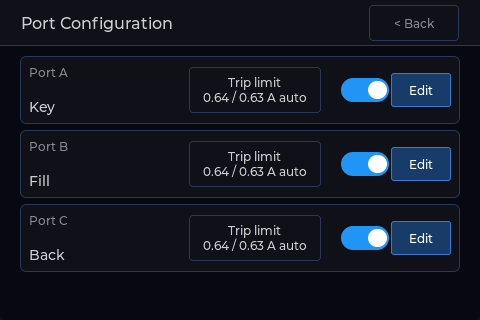

- The switch enables or disables a port. Disable ports with no panel attached; disabled ports are dark and skipped by protection and Panel Check.
- **Edit** renames the panel.
- **Trip limit** shows the over-current limit for each channel and opens the editor.

#### Trip limit

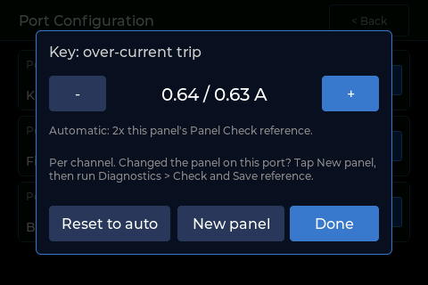

By default the limit is twice the current recorded by Panel Check for that port, between 0.40 and 2.40 A, or 1.80 A if no reference has been saved.

- **− / +** set a manual limit. A warning explains the risk and must be acknowledged first.
- **Reset to auto** returns to the automatic limit.
- **New panel** clears the saved reference for the port. Use it after swapping in a different panel, then run Panel Check and save a new reference.

### Edit Presets

Sets the color temperature and name of the three presets shown on Panel Detail.

### Output

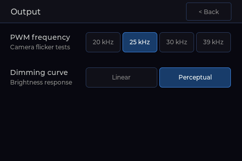

- **PWM frequency:** 20, 25 (default), 30 or 39 kHz. All are far above the frame rates and shutter speeds that cause visible flicker. If a camera shows banding at a particular shutter speed, try another frequency.
- **Dimming curve:** **Perceptual** (default) spaces brightness steps evenly to the eye. **Linear** maps the percentage directly to PWM duty.

---

## Diagnostics

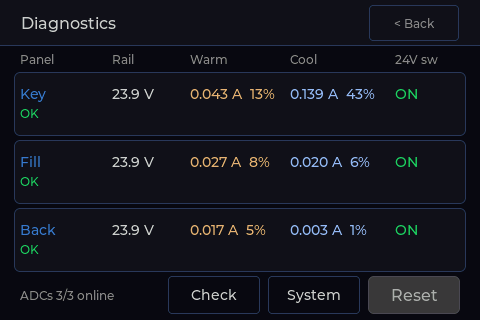

Live rail voltage, warm and cool current and PWM duty, and high-side switch state for each panel, refreshed four times a second. **Reset** clears a trip once the cause is fixed.

### Panel Check

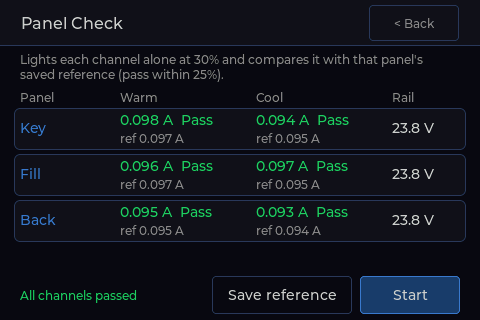

Lights each channel alone at 30 % and compares its current with the reference saved for that port. A channel passes within ±25 % of its reference. Panels return to their previous settings afterwards.

- Run it with known-good panels and tap **Save reference** to record each port's reference. This also sets the automatic trip limit.
- Run it again any time to confirm a panel and its cable are healthy.

### System

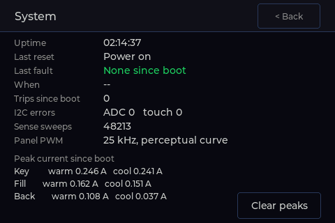

Uptime, last reset reason, last fault and when it happened, trip count, I2C error counts, PWM settings and peak current per channel since boot.

---

## Protection

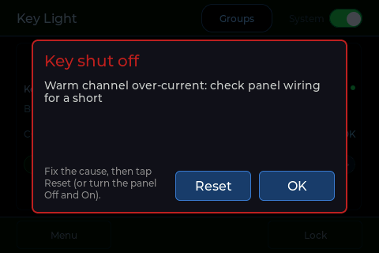

Each panel is monitored continuously. A **trip** switches that panel off and shows a popup. The panel stays off until the cause is fixed and it is re-armed with **Reset** or by switching it off and on.

| Trips | Warnings (panel stays on) |
|---|---|
| Over-current on a channel | Panel not drawing current (unplugged or open wiring) |
| MOSFET stuck on (current with the output off) | One channel not drawing current |
| Panel rail dead with the switch on (blown fuse or no 24 V) | Low rail voltage |
| High-side switch stuck on (rail live with the panel off) | Current sensing offline |

At power-up, a self-test switches each enabled panel's rail on with the LEDs off and checks that the rail is live and no current flows before restoring the panels.

The red status LED on the board is off in normal operation, blinks for a warning and is solid for a trip.

---

## Serial Console

Connect to the DevKit's USB port at 115200 baud and type `help`.

| Command | Action |
|---|---|
| `sense` | One reading of every channel |
| `stream <ms>` / `stream off` | Continuous readings |
| `faults` | Fault flags per panel |
| `clear` | Clear latched faults |
| `i2c` | Scan the I2C bus (touch 0x38, ADCs 0x48 to 0x4A) |
| `check` | Run Panel Check |
| `on` / `off` | System on or off |
| `on A` / `off B` | One panel on or off |
| `ver` | Firmware version |
| `log on` / `log off` | Verbose logging |
