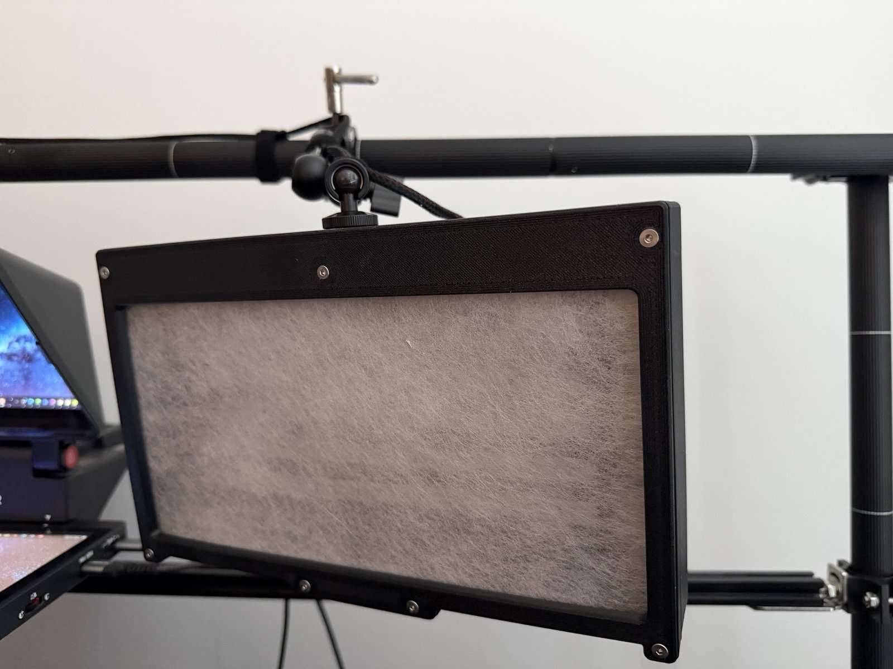
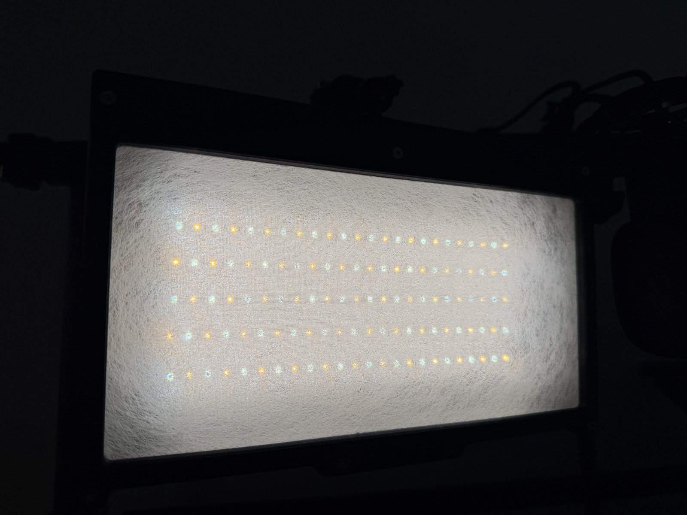

# Panel Reference Design

A working panel design for this controller, provided as a reference. Any 24 V warm/cool LED panel within the controller's ratings can be used.

The controller drives up to three panels, each with warm and cool LED channels.

## This Design

Three identical panels, each housing a single warm+cool LED channel pair:

- **Overall dimensions:** 255 × 128.5 mm
- **LED strips:** Yuji YJ-BC-HRB-2835-24-2765, 100 mm segments. 5 strips × 200 mm = 1.0 m of strip per panel, about 0.32 A per channel at 24 V at full output.
- **LED-to-diffuser gap:** 30 mm
- **Interior:** Matte black ABS lining
- **Backing:** 3 mm aluminum plate
- **Light trap lip:** 6–10 mm
- **Ventilation:** Passive

## Parts

| File | Description |
|---|---|
| `Key Light - Case.stl` | Main panel body |
| `Key Light - Bezel.stl` | Front bezel / diffuser frame |
| `Key Light - Retainer Sleeve.stl` | Diffuser retainer |
| `Key Light Housing.step` | Full assembly STEP file (editable in any CAD tool) |
| `Key Light Housing.f3z` | Fusion 360 source archive |

## Hardware (per panel)

- 7 M3 × 5 × 4 mm heat-set inserts (Voron standard, the same as the controller enclosure)
- 7 M3 flat head screws
- 1 or 2 1/4-20 heat-set inserts for mounting: one is required, the second is optional. The build used [these](https://www.amazon.com/dp/B078458CZY).

For three panels: 21 M3 inserts, 21 M3 flat head screws and 3 to 6 1/4-20 inserts.

## Connector

Each panel connects to the controller via a GX12-3 aviation connector:
- **Pin 1:** +24V
- **Pin 2:** Warm LED −
- **Pin 3:** Cool LED −
- **Shell:** Isolated (not grounded)

Use the same pinout on every panel and connector.

## Build Your Own

The controller is not tied to this geometry, strip density or diffuser. Any 24 V panel with separate warm and cool channels works, within the ratings in the top-level README (2.4 A per panel). Run Diagnostics > Check and save a reference after connecting a new panel.
